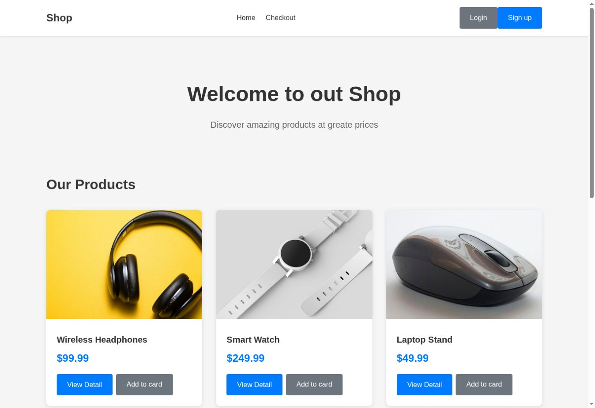
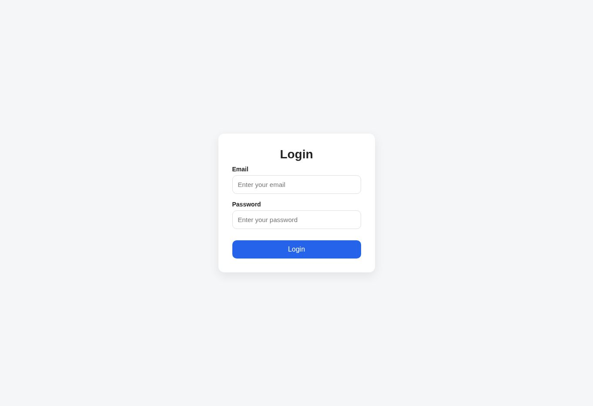
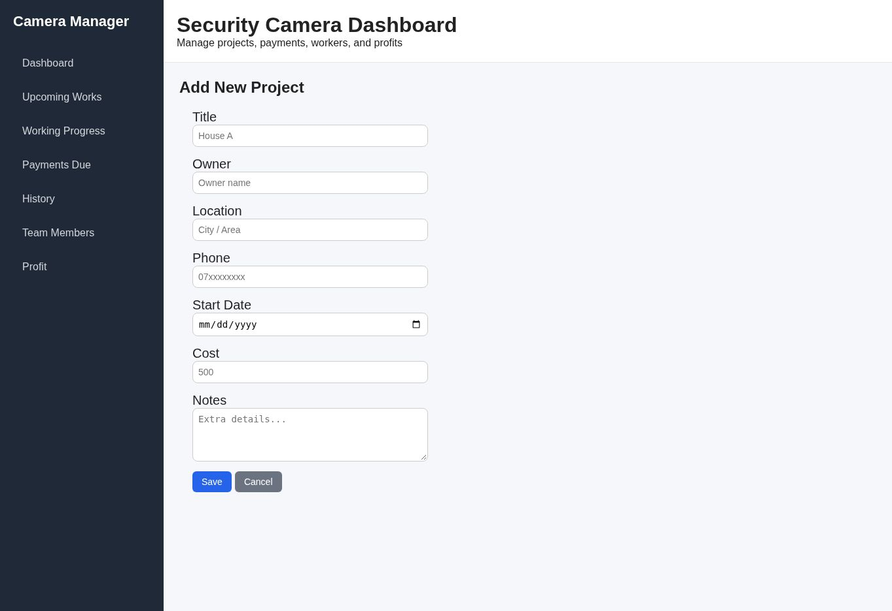

# Nwakhald · Project Showcase

A visual portfolio of web interfaces, business tools, and projects in progress.

**[Open the project gallery →](https://nwakhald-project-showcase.jazzytang64.chatgpt.site/)**

Application source repositories are private. This public repository contains project descriptions and screenshots only. The previews show development interfaces, not live applications.

## Projects

| Project | Focus | Technology | Preview |
| --- | --- | --- | --- |
| Ecommerce website | Product browsing and storefront UI | React, Vite, CSS | Storefront screenshot |
| Hardi POS System | Projects, team work, and payments | Laravel/PHP, React | Login component screenshot |
| Hardi Frontend | Business dashboard interface prototype | React, React Router, CSS | Project creation form screenshot |
| POS System Backend | Reserved backend repository | Not yet implemented | No application available yet |

## Ecommerce website

A storefront interface with product images, prices, reusable product cards, and navigation. Checkout and account routes are part of the project structure.

## Hardi POS System

A Laravel backend and React frontend project with modules for project management, team members, work sessions, and payments. This image shows the login component without any account credentials.

## Hardi Frontend

A separate React interface prototype for project work, payments, team members, and profit views. This image shows the project creation form with empty fields.

## POS System Backend

The repository is currently empty. It is reserved for future backend development and has no preview yet.

---

**Source privacy:** The original application files, backend code, and commit histories are kept in private repositories. This showcase does not provide source downloads.
